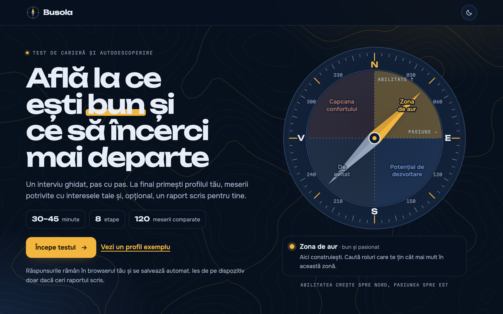
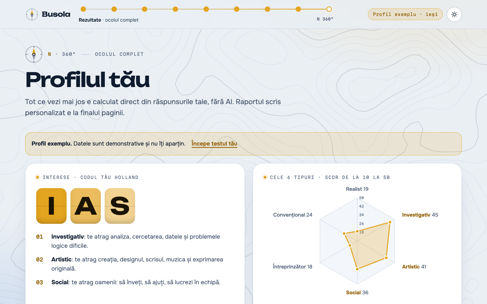
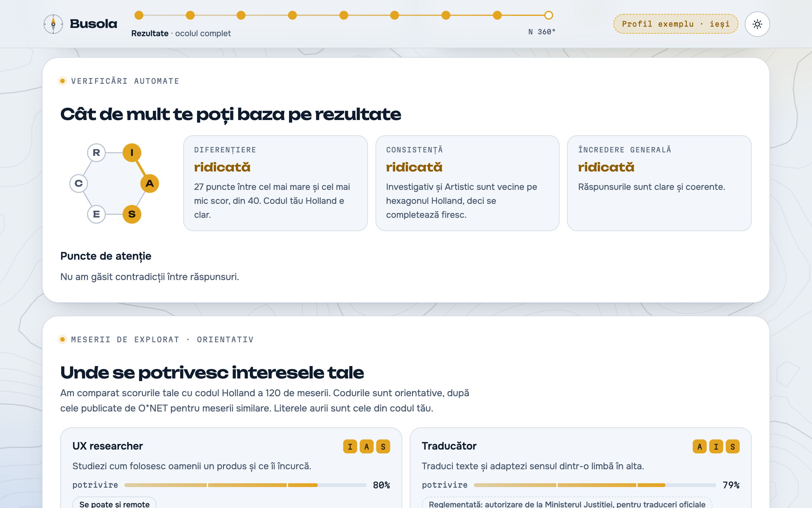
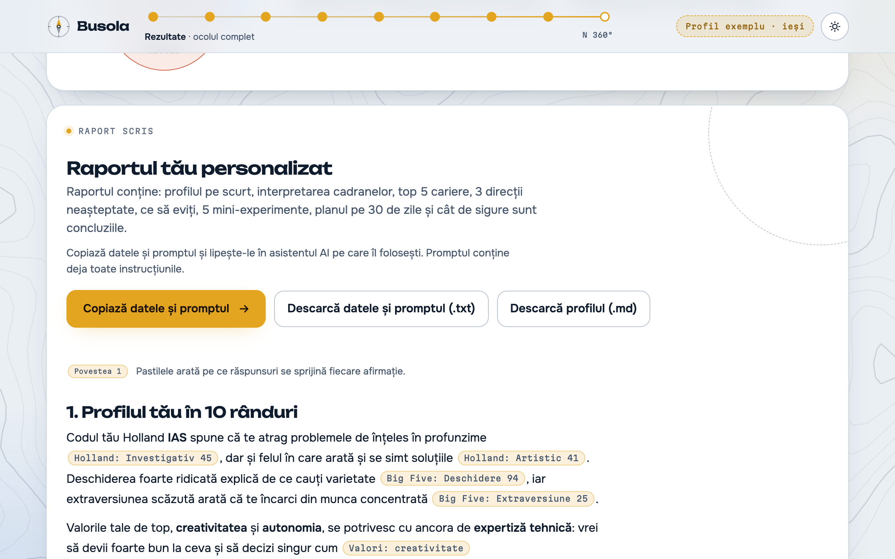
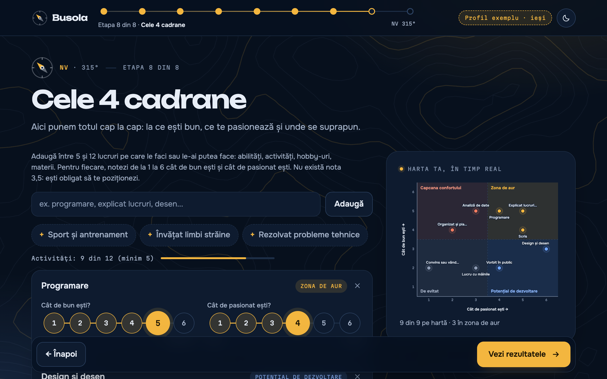
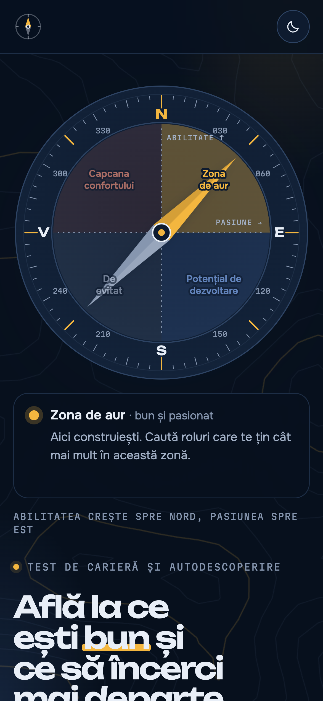
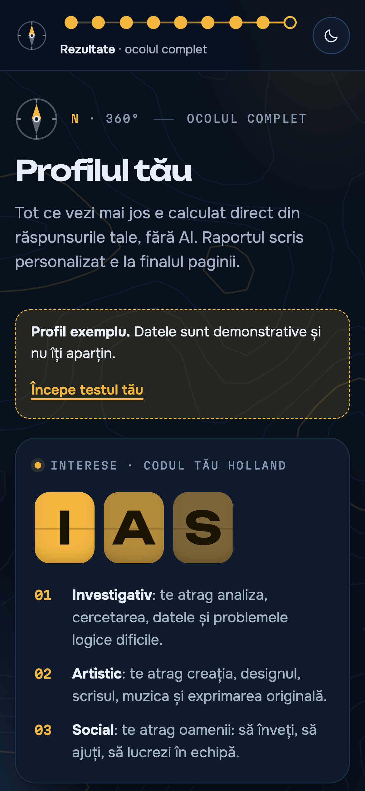

# Busola — Career Self-Assessment

A guided career and self-discovery assessment for Romanian speakers. In 8 steps it combines
Holland interest types (60 everyday activities) and the Mini-IPIP Big Five scale with values,
career anchors, work environment preferences, the person's own stories and a
skill-versus-passion matrix. The result is a profile and a list of matching
occupations, all calculated in the browser, plus an optional written report. It helps people
who feel stuck see where their interests, strengths and motivation overlap, and decide what to
try next.

"Busola" means "compass" in Romanian. The interface content is in Romanian, for a local audience.

**Live:** [manolacheioan.github.io/busola-career-assessment](https://manolacheioan.github.io/busola-career-assessment/) · [example profile](https://manolacheioan.github.io/busola-career-assessment/#exemplu)



**Tech stack:** HTML · CSS (custom properties, `color-mix`, View Transitions) · vanilla JavaScript · Canvas 2D · inline SVG · `localStorage` · Node test runner · Playwright · axe-core · GitHub Actions

---

## What I built

- **An 8-step guided interview:** context and practical constraints, interests (60 everyday
  activities, 10 per Holland type), personality (20 Mini-IPIP items, including
  reverse-keyed ones), work and learning styles, current state and work environment, values and career anchors,
  evidence stories, and the skill/passion matrix. Each step is validated before the user can
  move on, with a live hint explaining what is still missing.
- **A results page calculated without AI:** a 3-letter Holland code with ties explained, a radar
  chart of all 6 interest types, Big Five bars with the thresholds drawn on the track, work
  environment preferences, practical constraints, ranked values, career anchors, a scatter plot
  of the four quadrants and an Ikigai summary.
- **Wellbeing and self-esteem (optional, standard short scales):** the WHO-5 Well-Being Index,
  the PHQ-4 (PHQ-2 for low mood and GAD-2 for anxiety) and the Rosenberg Self-Esteem Scale,
  scored with their published methods and cut-offs, plus how often the person exercises and what
  gives them energy. The results show the scores with their cut-offs drawn on the bars, the
  checks flag low energy, low wellbeing and low self-esteem, and answers over the PHQ-2 or GAD-2
  cut-off bring a gentle suggestion to talk to a doctor or psychologist, with a support line.
  The interface says clearly that this is not a diagnosis.
- **What does not suit the person, without AI:** an optional deal-breakers question ("what
  would you not accept in a job", several answers allowed, plus free text) and a results card
  that gathers everything pointing the other way: deal-breakers, the two least attractive
  Holland types, activities rated "not at all", the "avoid" and "comfort trap" quadrants,
  environments rated at the far end of a scale and the story about a job the person disliked.
  The report prompt receives the same data and must say which matched occupations conflict
  with the deal-breakers.
- **Occupation matching:** the person's interest scores are compared with the Holland codes of
  120 occupations. Each match shows a fit percentage, the code letters it shares with the person,
  whether it can be done remotely, and whether it usually needs more study than the person
  currently has.
- **A live quadrant map:** while the user rates each activity from 1 to 6 for skill and passion,
  a side panel places it in one of four zones ("golden zone", "comfort trap", "growth potential",
  "avoid") and updates instantly.
- **Automatic profile checks, shown before any AI:** Holland differentiation (how far apart the
  scores are) and consistency (whether the top two types are neighbours on the Holland
  hexagon, drawn as a small diagram), an overall confidence level, tensions between answers
  (for example security as a value but an entrepreneurial career anchor) and answer-quality
  flags (the same rating almost everywhere, agreeing with opposite statements, very short
  stories, a 60-item step finished in under a minute).
- **Regulated professions:** occupations that need a licence or a professional body in Romania
  name it, for example the College of Psychologists for psychologists or ANRE authorisation
  for electricians.
- **An optional written report with visible evidence:** the answers, constraints, checks, the
  activities rated highest and lowest, and the matched occupations are turned into a structured
  two-part prompt. Every important claim in the report must cite its source in brackets, such
  as `[Povestea 1]` or `[Holland: Investigativ 45]`, and the page renders these as evidence
  pills. Where an AI runtime is available, the report is streamed into the page, with a stop
  button and the option to continue with part 2. Everywhere else, the user can copy or
  download the prompt and use it with any assistant.
- **An experiment tracker:** the mini-experiments from the report are parsed into a checklist.
  Before there is a report, five starting experiments are generated from the matched
  occupations and quadrants. For each one the user records "liked it / so-so / didn't like it"
  and a note, can add their own, and can ask for a report update ("What I learned from the
  experiments") based on the results.
- **Questions about the results:** a follow-up box where the user asks about their profile and
  gets a short answer, with evidence, that has the full profile, report and experiment results
  as context. The conversation is saved with the rest of the answers.
- **Export:** the profile downloads as Markdown, the prompt as a text file, and the results page
  has a print stylesheet for saving as PDF.
- **An interactive compass on the home page:** the needle follows the pointer with spring
  physics, and the quadrant it points to is highlighted and described below it.
- **A generative topographic background:** contour lines computed in real time from 3D Perlin
  noise with a marching squares algorithm. Every fifth line is an index contour, the terrain
  rises under the cursor and drifts with scroll.
- **Compass-based navigation:** each step maps to a compass bearing (N 000° to NW 315°), shown in
  a clickable route in the header, and the results close the circle at 360°.
- **Example profile:** opens a complete, pre-filled profile (also directly at `#exemplu`) without
  overwriting the user's own saved answers.
- **Light and dark themes** that follow the system setting, with a manual toggle that reveals
  the new theme in a circle from the button.

## Screenshots

| Results: Holland code and interest radar | Profile checks and matched occupations |
| --- | --- |
|  |  |
| **Written report with evidence tags** | **Skill/passion matrix with the live map** |
|  |  |

<p>
  
  &nbsp;
  
</p>

## Decisions and why

| Decision | Why |
| --- | --- |
| **Everyday activities for interests** | Formal interest inventories describe work settings that read oddly in Romanian ("build kitchen cabinets", "raise fish in a hatchery"). Hobbies, chores and school or work situations are easier to picture. Ten items per type keep the scores stable; the interface says the items follow the Holland model but are not a validated inventory. |
| **Standard scales for wellbeing and self-esteem** | Mood, anxiety and self-esteem are sensitive, so the app uses short, widely used scales (WHO-5, PHQ-4, Rosenberg) with their published scoring and cut-offs instead of self-written questions and invented thresholds. They are optional and every score needs all of its items answered. |
| **A published scale for personality** | The Mini-IPIP is short, public domain and validated in English, with reverse-keyed items in every dimension. The interface states that the Romanian translation has not been validated separately. |
| **Scoring and data in their own file (`scoring.js`)** | The question banks, occupation table and scoring functions have no DOM code, so the same file runs in the browser and in Node unit tests. |
| **Occupation matching in the browser** | The app gives concrete directions even with no AI available. AI is used only for the optional written report. |
| **Weighted fit (3, 2, 1) on the occupation's code letters** | The first letter of a Holland code matters most. Weighting by position ranks an IAS occupation above an SAI one for an IAS person, which a plain sum would not. |
| **Constraints as single-choice questions** | Time, education, mobility and budget used to be free text. As structured answers they can flag occupations that need more study and make the report prompt more precise. |
| **No framework, no build step** | The app is a sequence of forms and charts, which plain DOM rendering handles well. It opens directly from disk and runs on any static host. |
| **Answers stored only in `localStorage`** | No backend and no accounts. Progress is saved after every change and can be resumed, and nothing leaves the device unless the user asks for the report. Answers from the first version are migrated, keeping the free-text parts. |
| **Charts drawn by hand in SVG** | The radar and the quadrant plot take their colours from the same CSS tokens as the rest of the page, so they work in both themes without a charting library. |
| **Canvas for the background, SVG for the charts** | The contour lines are recalculated many times per second, which suits a canvas. The charts are static and need crisp, accessible text, which suits SVG. |
| **Own Markdown renderer that escapes HTML first** | The report text comes from a model. Escaping before formatting means it can only produce headings, lists, bold and italics, never markup or scripts. |
| **Evidence tags in a fixed vocabulary** | Asking the model to cite `[Povestea 1]` or `[Holland: Investigativ 45]` makes unsupported claims easy to spot, and a fixed set of forms keeps the tags short and consistent. |
| **Checks calculated in code, then passed to the model** | Differentiation, consistency, tensions and answer quality follow fixed rules, so they are the same every time and visible without AI. The report's confidence section starts from them instead of the model guessing. |
| **Experiments parsed from Markdown, with a calculated fallback** | The prompt asks for one list item per experiment, starting with a bold title, which is simple to parse while streaming. When there is no report, the tracker still works with experiments built from the profile. |
| **Limits stated in the interface** | Occupation codes are labelled as indicative, multiple intelligences are presented as preferred styles because the model is weakly validated, and the zodiac is a hidden bonus that is excluded from every conclusion. |

## Quality

**Automated testing**
- **Unit tests** (Node test runner) for the scoring core: question bank structure, RIASEC sums
  and tie detection, Big Five reverse keying and thresholds, quadrant boundaries, occupation fit,
  the extra-study and regulated-profession flags, Holland differentiation and consistency, every
  tension and answer-quality rule, WHO-5, PHQ-4 and Rosenberg scoring and their cut-offs,
  experiment parsing and the starting experiments.
- **End-to-end tests** (Playwright, on a desktop and a mobile profile): completing all 8 steps
  and checking the calculated code and occupations, step validation, saving and resuming after
  a reload, reopening steps from the route, the live quadrant map, the example profile not
  overwriting saved answers, Markdown and text downloads, tie messages, the zodiac bonus, the
  two-click reset, the experiment tracker and its persistence, the checks card, the
  "does not suit" card and deal-breakers, the wellbeing scores, the theme
  toggle, the "saved" indicator and the absence of horizontal scroll.
- **AI flows with a mocked runtime:** a stand-in for the AI API records every prompt and returns
  fixed Markdown, so the tests can check the evidence pills, that the prompt carries the checks
  and the raw answers, that experiments from the report become a tracker, the report update and
  the follow-up questions.
- **Accessibility audit** with axe-core (WCAG 2.2 AA rules) on the home page, the context step,
  the interests step and the results page, in both themes.
- A test checks that the only external requests are for Google Fonts.
- GitHub Actions runs the unit and end-to-end tests on every push and pull request.

**Accessibility**
- Rating scales and single-choice questions use `role="radiogroup"` with `aria-checked`.
  Multi-select options use `aria-pressed`. Every text field has an accessible label.
- Validation hints and report status are announced through `aria-live` regions.
- All controls are native buttons and work from the keyboard, with a visible focus outline and
  touch targets of at least 24 × 24 px. Values are reordered with up/down buttons instead of
  drag and drop.
- With `prefers-reduced-motion`, animations and transitions are turned off, the background is
  drawn once as a static image and the compass needle snaps instead of swinging.

**Performance**
- No runtime dependencies. The only external resource is Google Fonts.
- The background canvas redraws at about 24 frames per second, caps the pixel ratio at 1.5 and
  draws each line type as a single `Path2D`. It pauses automatically in background tabs.
- Inside a step, answering a question updates only the affected elements, so entry animations
  do not replay and the scroll position stays put.

**Security and privacy**
- No backend, no analytics, no cookies.
- User input and model output are HTML-escaped before they are inserted into the page.
- All `localStorage` access is wrapped in `try/catch`, so the app still works when storage is
  blocked, for example in private browsing.

## Project structure

```
index.html              the application: styles, step views, charts, compass, background
scoring.js              question banks, occupation table and pure scoring functions
tests/unit/             Node unit tests for scoring.js
tests/e2e/              Playwright end-to-end and axe accessibility tests
scripts/serve.js        minimal static server used locally and by the tests
playwright.config.js    desktop and mobile test profiles
docs/screenshots/       images used in this README
.github/workflows/      CI
```

## Running locally

Open `index.html` in a browser. To serve it over HTTP instead:

```bash
npm run serve
# then open http://localhost:4173
```

To run the tests:

```bash
npm install
npm test
```

Locally, the end-to-end tests use the installed Google Chrome. In CI they use Playwright's
Chromium (`npx playwright install chromium`).

## Configuration

No configuration is needed. Answers are stored in `localStorage` under the key `busola-v2`, and
the theme choice under `busola-theme`. The written report is generated when the page runs in an
AI runtime that exposes `window.claude.use("sample")`; elsewhere the report section offers the
prompt for copying or downloading instead.

---

Interest items were written for Busola following the Holland RIASEC model. Occupation codes
are indicative and modelled on those published by O*NET. Wellbeing uses the WHO-5 Well-Being Index (World Health Organization),
the PHQ-4 (Kroenke et al., 2009) and the Rosenberg Self-Esteem Scale (Rosenberg, 1965), translated for
this test. Personality items are from the Mini-IPIP
(Donnellan et al., 2006), part of the public-domain International Personality Item Pool. The
example profile contains illustrative data.
